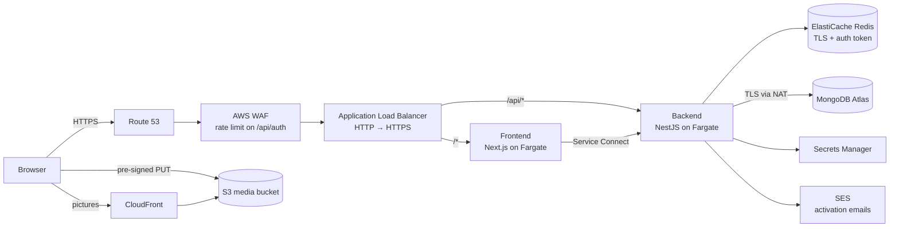
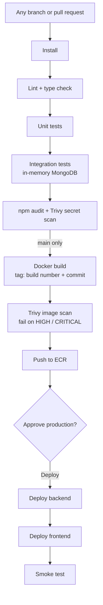

# Readers Book Club – Book Rental and Sales Platform on AWS

A web application for a Nigerian readers' club: members browse a catalog of books to rent or buy,
subscribe to rental plans, and every physical copy carries its own QR code for check-out and
returns. I designed the AWS platform it runs on and the pipeline that ships it, and built the
application itself.

**Live:** https://teeblissreadersclub.click

> The source code is private. This repository shows the architecture, the infrastructure, the
> delivery pipeline and selected excerpts. I'm happy to walk through the full codebase in an
> interview.

---

## At a glance

| | |
|---|---|
| **Application** | Next.js 16 (TypeScript, Tailwind, React Query, Zod) · NestJS 11 API · MongoDB Atlas · Redis |
| **Cloud** | AWS `eu-west-1`: ECS Fargate, ALB + WAF, ECR, ElastiCache Redis, S3 + CloudFront, Secrets Manager, SES, Route 53, CloudWatch, SNS |
| **Infrastructure as code** | Terraform: 9 reusable modules, separate `shared`, `staging` and `production` stacks, S3 remote state |
| **CI/CD** | Jenkins multibranch pipeline on EC2, Docker, Trivy, manual approval before production |
| **Tests** | 65 unit and end-to-end tests, run against an in-memory MongoDB replica set on every branch |
| **Outcome** | Live in production. Every merge to `main` is tested, scanned, built and deployed after one click |

## What the application does

**Live today**

- **Catalog:** books to rent or buy, with search, filters, paging and picture galleries
- **Accounts:** sign-up, sign-in and email activation; roles for admins, staff and members
- **Admin:** add books with details, pictures and physical copies; every copy gets an inventory
  code and a QR token
- **Data layer:** subscription plans, memberships, rentals, orders and scans, with rules enforced
  by the database itself (a copy can't be rented twice; a member can't hold two live memberships)

**Next:** Paystack/Flutterwave payments, the rental flow, the staff QR scanner, and SMS and email
reminders.

## Architecture

- **Two Fargate services behind one load balancer.** The ALB sends `/api/*` to the backend and
  everything else to the frontend. Inside the cluster the frontend reaches the backend through
  ECS Service Connect.
- **Private by default.** Tasks and Redis live in private subnets. Security groups only allow
  internet → ALB → services → Redis.
- **Uploads skip the API.** Admins get a short-lived pre-signed URL and upload pictures straight
  to a private S3 bucket that only CloudFront can read. The signature fixes the file type and
  size, and the backend checks each file's first bytes before using it.
- **Production runs two of everything** across two availability zones: two NAT gateways, two
  Redis nodes with failover, and CPU autoscaling between 2–4 frontend and 2–6 backend tasks.

## Infrastructure as code

Everything in AWS is Terraform. Staging and production use the same modules, and their
`main.tf` files are identical except for one `settings` block
([`excerpts/production-settings.tf`](excerpts/production-settings.tf)), so staging really does
prove production.

| Module | What it creates |
|---|---|
| `network` | VPC, public and private subnets in 2 AZs, NAT gateways, S3 gateway endpoint, security groups |
| `alb` | Load balancer, ACM certificate, HTTPS redirect, path routing, DNS record, WAF |
| `ecs` | Fargate cluster, task definitions, services, IAM roles, autoscaling, Service Connect |
| `ecr` | Image repositories with scan on push and a lifecycle policy |
| `redis` | ElastiCache Redis with TLS, an auth token and failover |
| `media` | Versioned, encrypted S3 bucket behind CloudFront with origin access control |
| `secrets` | Secrets Manager entries; hand-set values never pass through Terraform state |
| `jenkins` | Jenkins server on EC2 with Docker, Trivy and the AWS CLI, an IAM role and daily disk snapshots |
| `monitoring` | Log groups, SNS email alerts and alarms for 5xx errors, unhealthy targets, CPU, memory and Redis memory |

State lives in S3 with S3's native locking, so no DynamoDB table is needed.

## Delivery pipeline

Full pipeline: [`excerpts/Jenkinsfile`](excerpts/Jenkinsfile). Key decisions:

- **No AWS keys in Jenkins.** The Jenkins server has an IAM role scoped to ECR and ECS.
- **Every image is traceable.** Tags combine the Jenkins build number and the commit
  (`42-a1b2c3d`), and production runs exactly the image that passed the scans.
- **A deploy only succeeds if the new version is really running.**
  [`ecs-deploy.sh`](excerpts/ecs-deploy.sh) registers a new task definition, waits for the service
  to stabilise, and fails if the ECS circuit breaker rolled back to the old revision. A smoke
  test then checks the site and `/api/health`.
- **Backend before frontend,** so a new page never calls an API that doesn't exist yet.
- **Approval never blocks other builds.** The approval step waits without holding an executor,
  and a newer build reaching approval cancels the older one.
- **Lean, hardened images.** Multi-stage builds, non-root user, health checks, and npm, yarn and
  corepack removed from the runtime image ([`excerpts/Dockerfile.backend`](excerpts/Dockerfile.backend)).
- **Sized for a small server.** Installs and builds run one at a time, so the whole pipeline fits
  on a 4 GB Jenkins instance.

## Security

- Argon2 password hashing and a constant-time answer for unknown emails
- 15-minute JWT access tokens and 7-day refresh tokens in httpOnly cookies, with rotation and
  reuse detection ([`excerpts/refresh-token-rotation.ts`](excerpts/refresh-token-rotation.ts))
- Role-based access control enforced by the API on every request, not just hidden in the UI
- Rate limits in the app (10 requests a minute per IP on sign-in and sign-up) and in the WAF
- Input validation, Helmet and CORS; secrets only in Secrets Manager
- Trivy scans for committed secrets and vulnerable images on every build

## Problems I solved

| Problem | What I did |
|---|---|
| **Trivy failed the first production build** on HIGH findings in the npm, yarn and corepack copies bundled with `node:20-alpine` | The runtime only needs `node`, so the image now removes those tools and runs `apk upgrade` for OpenSSL fixes. Both images scan clean |
| **The backend image could not be built:** argon2's Alpine binary crashed, and the image has no compiler to rebuild it | Switched to `@node-rs/argon2`, which ships tested binaries for Alpine and keeps the same hash format |
| **Two browser tabs refreshing at once signed the user out everywhere:** a read-then-save let both issue a token, so the next refresh looked like token theft | Rotation is now a single atomic `findOneAndUpdate`, plus a 30-second grace period, with end-to-end tests for both cases |
| **Jenkins missed pushes from GitHub** | GitHub had added new webhook source ranges; the Jenkins security group now allows them |
| **The first `main` build failed at `docker build`** with an empty AWS region in the registry name | Region and app URLs moved into the `Jenkinsfile`, so they're reviewed with the pipeline |
| **Database lookups silently matched nothing:** reference fields were stored as untyped values | Fixed the schema types and added a test that checks every schema |
| **Members could not activate accounts** while SES was still in its sandbox | Added a `require_email_verification` switch in each environment's Terraform settings, so sign-up works now and activation emails switch on with one `terraform apply` |
| **Staging cost money with no members yet** | Made the staging deploy optional and tore staging down; the README lists the steps to bring it back |

## What I would improve next

- Add Prometheus and Grafana dashboards alongside the CloudWatch alarms
- Move Jenkins agents to short-lived containers, so builds no longer share one server
- Connect MongoDB Atlas over PrivateLink instead of the NAT gateways
- Add load tests and a scheduled backup restore test before launch

## Tech stack

TypeScript · Next.js · NestJS · MongoDB Atlas · Redis · Docker · Jenkins · Trivy · Terraform ·
AWS (ECS Fargate, ECR, ALB, WAF, ElastiCache, S3, CloudFront, Secrets Manager, SES, Route 53,
CloudWatch, SNS, IAM) · GitHub

---

**Ebenezer Olaleye** · DevOps Engineer · [LinkedIn](https://linkedin.com/in/ebenezerolaleye)
